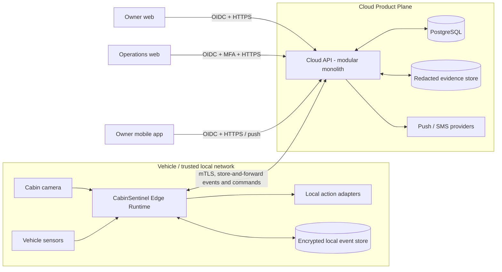
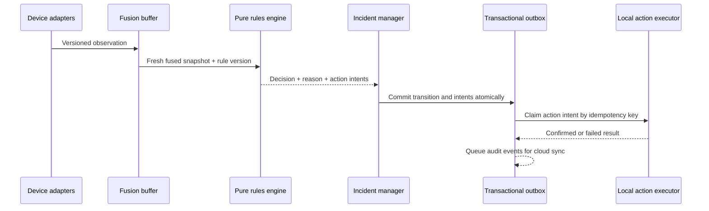

# CabinSentinel Architecture

Status: Target architecture (V2)  
Last reviewed: 2026-10-02  
Scope: Edge runtime, cloud platform, owner web, operations web, and mobile app

## 1. Executive decision

CabinSentinel will use an **Edge-first, Cloud-assisted architecture** with two
separate planes:

1. The **Safety Plane** runs in or near the vehicle. It owns perception, sensor
   fusion, deterministic safety rules, local persistence, and local emergency
   actions. It must continue operating without Internet.
2. The **Product Plane** runs in the cloud. It owns identity, vehicle ownership,
   remote read models, notifications, administration, analytics, and audit
   access. It may mirror an Edge decision, but it must not downgrade or replace
   a safety decision made at the Edge.

The cloud backend starts as a **modular monolith**, not a collection of
microservices. The current team and traffic do not justify the operational cost
of microservices. Modules have explicit boundaries and can be extracted later
only when load, ownership, or deployment needs require it.

The existing React dashboard and synchronous upload endpoint remain a clearly
labelled **technical demo**, separate from the production owner and operations
experiences.

## 2. Architectural invariants

These are non-negotiable system properties derived from the PRD and safety
flow:

- An Internet, cloud, push-provider, or LLM outage cannot stop local detection,
  rule evaluation, logging, horn activation, or another approved local action.
- Only the deterministic rules engine assigns `SAFE`, `NOTICE`, `WARNING`,
  `CRITICAL`, or `ERROR`. UI clients and LLMs never calculate or override risk.
- A missing, stale, blocked, or failed perception source never becomes proof of
  an empty cabin.
- A lower-risk state cannot overwrite an unresolved higher-risk incident without
  fresh evidence and an allowed state transition.
- Every accepted input, decision, rule version, state transition, action intent,
  action result, and acknowledgement has an immutable identifier and timestamp.
- Raw cabin images stay inside the perception boundary. Only redacted evidence,
  metadata, or short-lived signed references may leave it.
- Remote commands are authenticated, authorized, idempotent, time limited, and
  confirmed by device feedback. A UI success state is never based only on a
  submitted request.
- Safety behavior is versioned and testable without LangGraph, a network, a
  database, or an LLM.

## 3. System context



## 4. Safety Plane (Edge Runtime)

### 4.1 Components

| Component | Responsibility | Current code to retain/evolve |
| --- | --- | --- |
| Device adapters | Receive camera, radar, temperature, engine, door, HVAC and vehicle-mode data | `services/api/src/cabinsentinel/mqtt.py`, `models.py` |
| Perception adapter | Run the approved model, validate output, redact evidence before export | `services/api/src/vision/provider.py`, `vision_adapter.py` |
| Fusion buffer | Order and join inputs by event time within a bounded window; reject duplicate/future input | logic currently in `CabinService` |
| Occupancy estimator | Produce `PRESENT`, `SUSPECTED`, `ABSENT`, or `UNKNOWN` and preserve conflicts | `rules.py` |
| Safety rules engine | Pure deterministic state transition and action-intent calculation | extract and strengthen `rules.py` |
| Incident manager | Maintain incident lifecycle, severity monotonicity, acknowledgement, cooldown and escalation | evolve `CabinService` |
| Action executor | Execute local commands idempotently and record requested/accepted/confirmed/failed states | replace `MockActions` behind a port |
| Local event store | Append-only audit events plus materialized current state | SQLite WAL for one Edge device |
| Sync agent | Upload events in order, retry with backoff, receive signed commands, keep an outbox | new module |

### 4.2 Internal data flow



The current implementation correctly commits an action intent before calling an
external adapter. V2 formalizes this as a transactional outbox so a process
crash cannot silently lose an action or execute it twice.

### 4.3 State machine rules

- Keep the rules function pure: input snapshot + previous incident state +
  current time + rule version -> decision and intents.
- Replace scattered string constants with versioned enums and a rule registry.
- Add explicit transition policy. `ERROR` describes inability to verify; it does
  not automatically close an active `WARNING` or `CRITICAL` incident.
- Keep detection confidence separate from risk severity. Thresholds belong to a
  signed, versioned model/rule configuration.
- Require multi-frame voting and hysteresis from the PRD before making a safety
  readiness claim. The current single-frame demo is not sufficient.
- LangGraph may orchestrate non-critical workflows, but the safety rule package
  must remain independently callable and independently testable.

### 4.4 Edge storage

SQLite remains appropriate for one Edge process when configured with WAL,
foreign keys, migrations, bounded retention, and encrypted storage. Recommended
logical tables:

- `observations`: append-only sensor/perception metadata;
- `incidents`: one lifecycle per safety event;
- `state_transitions`: old/new state, rule ID and rule version;
- `action_intents` and `action_results`;
- `acknowledgements`;
- `outbox_events` and `inbox_commands`;
- `device_config_versions`.

Do not store raw frames in these tables. A redacted evidence artifact has a
content hash, retention deadline and local/cloud storage reference.

## 5. Product Plane (Cloud modular monolith)

### 5.1 Modules

| Module | Owns |
| --- | --- |
| Identity and access | OIDC identities, sessions, roles, MFA policy |
| Accounts | users, households/organizations, consent and preferences |
| Fleet registry | vehicles, devices, ownership, pairing and certificates |
| Incident read model | synchronized Edge incidents, timelines and current vehicle status |
| Command gateway | authorized remote requests, expiry, idempotency and device confirmation |
| Notifications | push/SMS/email policy, retries, delivery receipts and escalation |
| Evidence | redacted artifact metadata, signed access and retention deletion |
| Operations | support queues, device health, rule/model rollout and maintenance |
| Audit | security and administrative audit trail |
| Demo | isolated image-upload flow with no production claims or data mixing |

Modules should communicate through application interfaces and domain events
inside one deployment. Long-running or retryable work uses a worker consuming a
PostgreSQL outbox. Introduce Redis only when measured needs appear (rate limits,
short-lived locks, or fan-out); it is not a source of truth.

### 5.2 Cloud persistence

Use PostgreSQL in cloud environments. Keep one database initially, with schema
ownership by module and migrations through Alembic. Core relations are:

```text
accounts -> memberships -> roles
accounts -> vehicle_access <- vehicles -> devices
vehicles -> incidents -> incident_events
incidents -> action_attempts
incidents -> acknowledgements
incidents -> redacted_evidence
devices -> heartbeats / software_versions
users -> notification_endpoints / preferences
all privileged operations -> audit_entries
```

Each synchronized event includes `event_id`, `device_id`, `vehicle_id`,
`occurred_at`, `received_at`, `sequence`, `schema_version`, `rule_version`,
`payload`, and `payload_hash`. The server deduplicates by device and event ID;
arrival order never replaces event time.

## 6. Client architecture

### 6.1 Applications

- **Owner web:** responsive status, vehicle overview, incident detail, history,
  privacy controls and account settings.
- **Operations web:** multi-vehicle queues, device health, incident investigation,
  audit, controlled configuration rollout and support tooling.
- **Mobile:** push-first owner experience, incident details, acknowledgement,
  emergency guidance, vehicle status and notification preferences.
- **Demo web:** current scenario/image workflow; visually and operationally
  separated from authenticated production applications.

Owner and operations navigation must be separate. Sharing an application shell
and hiding admin links is not a security boundary.

### 6.2 Shared code

Use a TypeScript workspace and share protocol/domain code, not DOM components:

```text
apps/
  owner-web/          React + Vite
  operations-web/     React + Vite
  mobile/             Expo + React Native
  demo-web/           migrated current frontend
packages/
  api-client/         generated OpenAPI client, auth and error mapping
  contracts/          generated schemas and domain enums
  domain/             display-safe derived values; never risk calculation
  design-tokens/      color, type, spacing and state semantics
  test-fixtures/      golden incident timelines
edge/
  runtime/            Edge composition root and adapters
backend/
  app/                cloud modular monolith
```

The web apps may share accessible headless behavior and design tokens. React
Native receives its own visual components because browser DOM components and
native controls have different behavior and accessibility contracts.

### 6.3 Client data behavior

- OpenAPI is the contract source; generate clients in CI instead of maintaining
  parallel handwritten backend/frontend interfaces.
- Use HTTPS for commands and initial reads. Use Server-Sent Events for live web
  incident updates; use push notifications for mobile wake-up followed by an
  authenticated refresh.
- Clients cache the last known decision with its timestamp and visibly mark it
  stale. Cached data is never presented as a new live decision.
- Acknowledgement and commands carry an idempotency key and expected incident
  revision to prevent double taps and stale writes.
- The mobile critical screen keeps the primary action above the safe area and
  retains temperature, time, occupant evidence and offline/online status.

## 7. Identity, authorization and device trust

Use an external OpenID Connect provider rather than building password storage.
The API validates access tokens and enforces authorization server-side.

Recommended roles:

| Role | Access |
| --- | --- |
| `OWNER` | Assigned vehicles, own incidents, preferences and acknowledgements |
| `CAREGIVER` | Explicitly shared vehicles and limited incident response |
| `OPERATOR` | Assigned operational queue and device diagnostics |
| `ADMIN` | Tenant configuration and role assignment; no implicit owner access |
| `AUDITOR` | Read-only audit and incident evidence under policy |

Authorization is relationship-based in addition to role-based: an `OWNER` can
only access vehicles linked through `vehicle_access`; an `OPERATOR` only sees
assigned tenants/queues. Admin and operator accounts require MFA.

Each Edge device has a unique certificate stored in hardware-backed storage
where available. Edge-cloud communication uses mTLS, certificate rotation,
nonce/replay protection and signed configuration packages. Device identities
are never browser API keys.

## 8. API boundaries

Recommended versioned resources:

```text
/api/v2/me
/api/v2/vehicles
/api/v2/vehicles/{vehicle_id}/status
/api/v2/vehicles/{vehicle_id}/incidents
/api/v2/incidents/{incident_id}
/api/v2/incidents/{incident_id}/acknowledgements
/api/v2/incidents/{incident_id}/commands
/api/v2/incidents/{incident_id}/stream
/api/v2/devices/{device_id}/events:batch       # device mTLS only
/api/v2/devices/{device_id}/commands:poll      # device mTLS only
/api/v2/operations/incidents                   # operator/admin policy
/api/v2/operations/devices
/api/v2/demo/analyze                           # isolated and rate limited
```

Return a stable error envelope containing `code`, safe `message`,
`correlation_id`, and optional validation details. Do not expose stack traces,
model paths, database errors, or internal authorization reasons.

## 9. Privacy and security boundaries

- Redact faces before any frame crosses the perception boundary. The current
  provider returns detections but does not implement the PRD face-redaction
  pipeline, so it is not yet privacy-complete.
- Encrypt transport and storage; rotate device and application credentials.
- Use short-lived signed evidence URLs and log each privileged evidence view.
- Default retention: metadata longer, redacted evidence shorter; make actual
  durations explicit in product policy and configurable by jurisdiction.
- Separate demo data from production accounts and databases.
- Apply upload byte, pixel, MIME and concurrency limits already present in V1;
  add malware/content handling if arbitrary uploads remain public.
- Protect state-changing routes with authorization, idempotency, rate limits,
  audit and optimistic concurrency.
- Never permit a remote admin console to directly invoke a vehicle actuator.
  Commands go through policy, expiry, Edge validation and device feedback.

## 10. Reliability and observability

### 10.1 Service objectives

| Signal | Initial target |
| --- | --- |
| Edge decision latency | p95 below 2 seconds end-to-end |
| Edge rule evaluation | p95 below 300 ms |
| Offline critical path | 100% of golden offline scenarios |
| Owner API availability | 99.9% monthly after production launch |
| Cloud event ingestion | 99% accepted within 60 seconds while connected |
| Critical push dispatch | p95 below 5 seconds after cloud receives event |

Push/SMS timing is not part of the offline safety guarantee. Track separate
timestamps for observation, inference, decision, intent, local confirmation,
cloud receipt, dispatch, delivery and user acknowledgement.

Use structured logs, metrics and traces joined by `correlation_id`, `incident_id`,
`vehicle_id` and `device_id`. Never include raw images, tokens, personal message
content, or secrets. Provide separate liveness, readiness and dependency health;
a missing vision model must remain visible as unavailable.

### 10.2 Required test layers

- pure rule-table tests and property tests for severity and stale-input rules;
- replay tests from recorded, anonymized observation streams;
- contract tests generated from OpenAPI and versioned device schemas;
- Edge crash/restart and outbox idempotency tests;
- fault injection for camera, MQTT, disk, clock skew and Internet loss;
- authorization matrix tests for every resource/action;
- mobile/web accessibility and critical-flow end-to-end tests;
- model evaluation by class, cabin position, light, occlusion and demographic
  slice using a reviewed dataset;
- golden scenarios from the PRD, including the known empty-detection false
  negative case.

## 11. Deployment topology

### Demo environment

- Cloudflare Pages may host `demo-web`.
- One Railway backend worker may serve the synchronous demo with SQLite and an
  explicitly supplied model.
- The UI must say that actions are simulated and stock YOLO is not validated for
  child-safety use.

### Product cloud environment

- Static web apps on a CDN/Pages service.
- Containerized FastAPI API plus a separate worker process.
- Managed PostgreSQL with automated backups and point-in-time recovery.
- Private object storage for redacted evidence.
- Managed push/SMS integration and secret manager.
- Staging and production use separate accounts, databases, buckets, keys and
  device certificate authorities.

### Edge environment

- Versioned signed image/package containing runtime, approved model and rules.
- Process supervision, local health checks, disk quotas and rollback slot.
- No runtime model or package auto-download.
- Controlled over-the-air rollout with canary cohorts and rollback by version.

## 12. Migration from the current repository

### Phase 0 - Stabilize the baseline

- Preserve `services/api/src/cabinsentinel/rules.py` behavior and the current tests.
- Label `/api/v1/demo/*` and the existing frontend as demo-only.
- Fix text-encoding issues in Markdown/UI strings.
- Remove the unused template chat/LLM path from production composition, or keep
  it in an explicitly separate example module.
- Record the stock-model false negative as a blocking safety-readiness risk.

Exit condition: all backend/frontend tests and builds pass reproducibly in CI.

### Phase 1 - Contracts and domain separation

- Introduce `Observation`, `Decision`, `Incident`, `ActionIntent`,
  `ActionResult`, `Acknowledgement` and `AuditEvent` schemas with versions.
- Extract the pure rule engine from FastAPI, SQLite and LangGraph.
- Generate the TypeScript API client from OpenAPI.
- Add database migrations and transactional outbox tables.

Exit condition: existing scenarios replay through the extracted engine with the
same or safer results.

### Phase 2 - Cloud foundation and access control

- Add PostgreSQL, OIDC integration, roles, vehicle relationships and audit.
- Add device registry and mTLS event ingestion.
- Implement incident read models and SSE.
- Keep all physical actions mocked until a reviewed device contract exists.

Exit condition: owner and operator APIs cannot cross account/vehicle boundaries
in automated authorization tests.

### Phase 3 - Product clients

- Move the current UI to `apps/demo-web`.
- Build `owner-web`, then `operations-web`, from the V2 API.
- Build Expo mobile around push, incident detail and acknowledgement.
- Share generated contracts, API client and design tokens.

Exit condition: user, operator and mobile critical flows pass end-to-end and
meet WCAG AA/mobile accessibility checks.

### Phase 4 - Production Edge and notifications

- Implement the Edge sync agent, signed configuration, local action adapters and
  delivery receipts.
- Add evaluated/redacted perception artifacts and model registry metadata.
- Run Internet-loss, clock-skew, restart, disk-pressure and rollback drills.

Exit condition: the measured Definition of Done is met on target hardware; no
safety claim is based only on a browser upload demo.

## 13. Decisions intentionally deferred

- Kubernetes: unnecessary until deployment scale or isolation requires it.
- Kafka: PostgreSQL outbox and worker are sufficient until measured throughput
  exceeds them.
- WebSockets: SSE covers server-to-web incident updates with simpler recovery;
  revisit only for genuine bidirectional real-time needs.
- Vector database/RAG: no role in the safety or core product path.
- LLM-generated alerts: optional convenience after deterministic templates are
  complete; never a blocker or decision maker.
- Multi-region active-active: defer until users, regulatory boundaries and
  recovery targets justify the complexity.

## 14. Current-state gaps that drive this design

- `CabinService` combines fusion, incident lifecycle, SQLite persistence and
  action orchestration in one class.
- APIs have no authentication, ownership checks, acknowledgement endpoint or
  production command contract.
- The current process loads CPU vision, HTTP, MQTT and storage together and is
  limited to one worker for the SQLite demo.
- Frontend polling is tied to one `VITE_VEHICLE_ID`; types duplicate backend
  contracts and there is no routing or role separation.
- Action adapters are simulated and unlock is only a pending data object.
- Event payloads are flexible JSON without a cloud synchronization envelope or
  formal retention policy.
- The evaluation report is still a template; latency, recall, coverage and user
  outcomes are not yet established.
- The stock detector has a documented child/infant false negative, so the
  current V1 is an integration demo, not a deployable child-safety system.

This architecture deliberately keeps the strong parts of V1 - validated input
contracts, deterministic local rules, stale-data handling, ordered ingestion,
audit intent, safe UI semantics and extensive regression tests - while adding
the missing product, trust, privacy and deployment boundaries.
