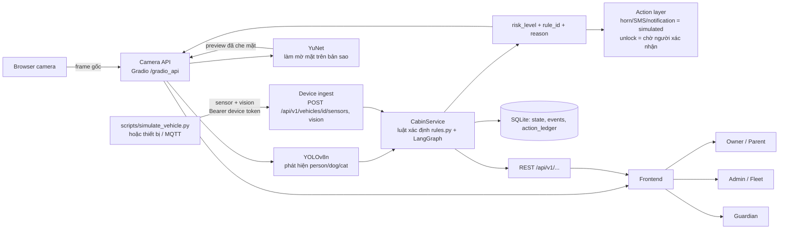

# Luồng Backend dành cho Frontend — CabinSentinel

Tài liệu này giải thích backend chạy thế nào, frontend gọi gì, và những quy tắc an toàn **bắt buộc** khi hiển thị. Đọc kèm [CAMERA_API_V1.md](CAMERA_API_V1.md) (chi tiết camera) và [MVP_QA_REPORT_2026-10-03.md](MVP_QA_REPORT_2026-10-03.md).

## 1. Bức tranh tổng thể



Ba điểm cốt lõi:

1. **Risk do backend quyết định, bằng luật xác định** (`src/cabinsentinel/rules.py`). Frontend **không tự suy** CRITICAL/SAFE từ danh sách detection hay nhiệt độ. Không có LLM trong đường quyết định.
2. **Frame gốc chỉ đi từ trình duyệt → backend.** Ảnh người dùng nhìn thấy luôn là `preview` do backend làm mờ mặt. Không bao giờ hiển thị video/frame gốc.
3. **Thiếu dữ liệu ≠ an toàn.** Dữ liệu cũ, mất mạng, lỗi → hiển thị `UNKNOWN`, không bao giờ `SAFE`.

## 2. Trạng thái rủi ro

`risk_level` ∈ `SAFE | NOTICE | WARNING | CRITICAL | ERROR`. `ERROR` = backend không đủ dữ liệu để quyết định (thiếu/cũ cảm biến hoặc camera).

| Quy tắc hiển thị | Cách làm |
|---|---|
| Chỉ coi verdict là "hiện tại" khi `decision_current === true` **và** request gần nhất thành công | Nếu không → hiện `UNKNOWN` (xem `displayRisk()` trong `frontend/src/api/fleet.ts`) |
| `risk_level = null` (xe chưa có dữ liệu) | `UNKNOWN` |
| Mất kết nối backend | `UNKNOWN`; giá trị cuối cùng gắn nhãn "last received · not current" |
| Giá trị chưa biết | Hiển thị `UNKNOWN`, không điền 0/false |

Ngưỡng TTL (backend): cảm biến **5 s**, camera/vision **3 s**. Quá hạn → `decision_current=false`, risk chuyển `ERROR`. Hot threshold demo: `35 °C`.

Ví dụ rule: `EMPTY_CABIN` (SAFE), `COOL_OCCUPANT` (WARNING), `HOT_OCCUPANT` (CRITICAL: có sinh vật sống + xe đỗ/khoá + ≥ 35 °C).

## 3. Xác thực (demo)

Token chỉ lưu **trong bộ nhớ** backend và trình duyệt. Không để trong URL, localStorage, hay biến `VITE_*`. Backend restart → mọi token mất hiệu lực → HTTP 403 → frontend phải quay lại màn đăng nhập (đã xử lý trong `FleetView`).

| Vai trò | Lấy token | Quyền |
|---|---|---|
| owner | `POST /api/v1/auth/demo-login {"role":"owner","subject":"demo-owner"}` | Xem xe của mình, tạo trip, ghi check-in |
| admin | `POST /api/v1/auth/demo-login {"role":"admin"}` | Xem mọi xe |
| guardian | Nhận `guardian_token` khi owner tạo trip | Chỉ đọc `child-status` của **đúng trip đó** |
| device | `CABINSENTINEL_DEVICE_TOKEN` (env, `scripts/run_backend.sh` tự sinh) | Chỉ ghi sensor/vision |
| demo session | Nhận `session_token` từ `/demo/analyze` hoặc `camera_start` | Chỉ đọc/ghi xe `DEMO_<session_id>` của chính nó |

`demo-login` **tự tắt khi `APP_ENV=production`**. Header: `Authorization: Bearer <token>`. Xe không tồn tại và xe không có quyền trả cùng một lỗi 403.

## 4. Các luồng sản phẩm

### Flow A — Owner / Parent (live camera)
`camera_start → (lặp) upload ảnh + camera_frame → camera_stop`. Chi tiết mục 5. Trang: `#live-cabin`.

### Flow B — Owner/Admin xem xe (fleet)
1. `POST /api/v1/auth/demo-login`
2. `GET /api/v1/vehicles` (poll ~2 s) → danh sách + tóm tắt
3. `GET /api/v1/vehicles/{id}/state` và `/events` (poll ~1.5 s) cho xe đang chọn

Tóm tắt xe (`/vehicles`):
```json
{"vehicle_id":"VF8-DEMO-01","vehicle_name":"Family SUV","online":true,"last_seen":"…",
 "risk_level":"CRITICAL","decision_current":true,"rule_id":"HOT_OCCUPANT","revision":42,
 "occupancy":{"state":"PRESENT","counts":{"person":1}},"temperature_c":39.2,
 "doors_locked":true,"alert_count":1,"active_incident":"<uuid>|null","data_source":"SIMULATED"}
```
`/vehicles/{id}/state` thêm: `sensors{temperature_c, door, ignition, radar_presence, status, age_s}`, `vision{camera_status, detections[], status}`, `risk{…}`, `explanation` (câu giải thích do backend sinh, xác định), `incident`, `unlock_request`, `actions[]`, `action_ledger[]`, `data_quality`.

**Chuyển xe:** mỗi xe là một component riêng (`key={vehicleId}`), kiểm tra `payload.vehicle_id === vehicleId`, và bỏ response về muộn của xe cũ (`active` flag). Test: `frontend/src/test/fleet-guardian.test.tsx`.

### Flow C — Guardian (đón trẻ)
1. Owner: `POST /api/v1/vehicles/{id}/trips {"label":"School pickup"}` → `{trip_id, guardian_token}`
2. Owner/thiết bị ghi sự kiện: `POST /api/v1/trips/{trip_id}/events {"event":"entered_vehicle|exited_vehicle","idempotency_key":"<uuid>"}` → `result: ACCEPTED | DUPLICATE`
3. Guardian (token riêng): `GET /api/v1/guardian/trips/{trip_id}/child-status`
```json
{"trip_id":"…","child_status":"INSIDE","last_event":"entered_vehicle","source":"MANUAL_CHECKIN",
 "confidence":null,"identity_verified":false,"event_count":1,"vehicle_safety":{"risk_level":"…","decision_current":true}}
```
`child_status` ∈ `INSIDE | EXITED | UNKNOWN`. Trạng thái chỉ đến từ **check-in được ghi nhận**, camera **không nhận diện đứa trẻ nào** — không được hiển thị như nhận diện danh tính.

### Flow D — Upload ảnh (REST)
`POST /api/v1/demo/analyze` (multipart: `image` JPEG/PNG ≤ 5 MiB, `scenario`, tuỳ chọn `session_id`). Lỗi: 413 quá lớn, 415 sai định dạng, 422 ảnh hỏng/scenario sai, 503 quá tải (có `Retry-After`) hoặc model lỗi. Nút gửi phải khoá khi đang chờ (single-flight).

## 5. Camera API (Gradio) — chi tiết giao thức

Mọi lệnh: `POST /gradio_api/call/{name}` body `{"data":[…]}` → `{"event_id"}`; sau đó `GET /gradio_api/call/{name}/{event_id}` đọc SSE, lấy sự kiện `complete` (`data: [ {…} ]`).

| name | data | Ghi chú |
|---|---|---|
| `camera_start` | `[scenario, "browser"]` | Trả `session_id` + `session_token` (chỉ một lần) |
| `camera_frame` | `[session_id, token, fileData, sequence, captured_at]` | `fileData` lấy từ `POST /gradio_api/upload` (multipart `files`) → `{"path":…, "meta":{"_type":"gradio.FileData"}}` |
| `camera_status` | `[session_id, token]` | Chỉ đọc, không có ảnh |
| `camera_stop` / `camera_report` | `[session_id, token]` / `[…, "ERROR\|DISCONNECTED\|STOPPED"]` | Vô hiệu hoá kết quả đang chạy |

Quy tắc gửi frame: **một frame một lần** (đợi kết quả rồi mới gửi tiếp), `sequence` tăng dần từ 1, `captured_at` ISO8601 có múi giờ, không lệch quá 3 s (`STALE_FRAME`) và không ở tương lai (`CLOCK_SKEW`). Gửi lại cùng sequence + cùng ảnh → `frame_result: "DUPLICATE"` (không chạy lại action). Cùng sequence khác ảnh → `FRAME_CONFLICT`.

Kết quả thành công: `risk_level, rule_id, reason, occupancy_state, decision_current, vision_detections[{class,confidence,bbox}], frame{sequence,captured_at,width,height,latency_ms}, actions[], action_ledger[], unlock_request, preview{…}`.
Lỗi: `{"error":"…","code":"STALE_FRAME|OUT_OF_ORDER|BUSY|STOPPED|UNAUTHORIZED|…","decision_current":false}` → coi như **không có quyết định hiện tại**.

### Hợp đồng `preview` (quyền riêng tư)
```json
{"status":"PROCESSED","method":"YUNET_SOFT_OVAL","sequence":3,"captured_at":"…","width":640,"height":480,
 "detected_faces":2,"masked_regions":2,"latency_ms":15.9,"model_sha256":"8f2383e4…","data_url":"data:image/jpeg;base64,…"}
```
Chỉ vẽ preview khi **tất cả** đúng: `status==="PROCESSED"`, `method==="YUNET_SOFT_OVAL"`, `sequence`/`captured_at`/`width`/`height` khớp `frame`, `data_url` là `data:image/jpeg;base64,…`, ảnh ≤ 3 s tuổi. Thiếu `preview`, `status:"UNAVAILABLE"`, lỗi, cũ, sai sequence → **ô trống "preview unavailable"**, **không bao giờ** dùng `<video>`/frame gốc làm fallback. `<video>` chỉ để capture và phải `hidden`. Ghi chú: bbox YOLO tính trên frame gốc, vẽ chồng lên preview cùng kích thước.

Lỗi privacy **không đổi risk** — chỉ ẩn ảnh. Preview không được lưu vào DB; các lệnh đọc không phát lại ảnh.

## 6. Action & unlock

| Action | `status` |
|---|---|
| `trigger_horn`, `send_sms`, `send_notification` | `simulated` (không có hành động thật) |
| `request_unlock` | `pending_human_confirmation` — **không bao giờ tự thực thi**; có thể `expired`/`canceled` |

Action chỉ xuất hiện trong `actions[]` của lần đánh giá tạo ra nó; các frame lặp **không phát lại**. Dùng `action_ledger[]` (biên nhận bền vững) và `unlock_request` để hiển thị trạng thái sau đó. Dùng nhãn "Mô phỏng / chờ xác nhận" trên UI. Hiện **không có** endpoint xác nhận unlock.

## 7. Health / năng lực

`GET /health` (alias `/ready`): `status` (`ok`/`degraded`, HTTP 200/503), `vision`, `database`, `mqtt`, `safety_timer`, và `capabilities`: `vision_model`, `privacy_model` (có `sha256`), `age_classifier` (`{"available":false,"reason":"checkpoint_unavailable"}`), `camera_api`, `fleet`. Thiếu `privacy_model` ⇒ preview bị ẩn (không bao giờ ảnh gốc). Age classifier **chưa có checkpoint**: không dùng nhãn tuổi trong UI/logic an toàn.

## 8. Idempotency & thứ tự

- Cảm biến: trùng/ngược `sequence` hoặc `timestamp` → trả state hiện có (`result: DUPLICATE_OR_STALE`, `actions: []`).
- Vision: trùng `frame_id` hoặc timestamp cũ → như trên.
- Frontend: bỏ response có `sequence` nhỏ hơn đã nhận cùng session (`isStaleCameraResult`), bỏ response của xe/session khác.
- `idempotency_key` cho check-in trip (UUID mới mỗi lần bấm; nút khoá khi đang gửi).

## 9. Chạy thử toàn bộ

```bash
# Terminal 1 — backend (http://127.0.0.1:7863)
./scripts/run_backend.sh
# Terminal 2 — frontend (http://127.0.0.1:5183) trong repo Cabin
./scripts/run_frontend.sh
# Terminal 3 — mô phỏng 4 xe (CRITICAL/WARNING/SAFE/OFFLINE)
.venv/bin/python scripts/simulate_vehicle.py
# kịch bản nhiệt độ tăng dần: --only --scenario VF9-DEMO-02=RAMP
```

Biến môi trường frontend: `VITE_API_BASE_URL`, `VITE_CAMERA_API_BASE_URL` (mặc định `http://127.0.0.1:7863`). Backend: `CORS_ORIGINS` (liệt kê origin, không dùng `*` ở production), `CABINSENTINEL_DEVICE_TOKEN`, `FACE_MODEL_PATH`, `MODEL_PATH`, `CABINSENTINEL_DEMO_LOGIN`.

## 10. Giới hạn đã biết

Xe fleet dùng dữ liệu **mô phỏng** (nhãn `SIMULATED`); phiên camera trực tiếp là xe demo riêng (`DEMO_<id>`), chưa gắn với xe fleet. Token/trip/camera session nằm trong bộ nhớ (restart là mất). Chưa kiểm thử webcam/Raspberry Pi thật. YuNet có thể bỏ sót mặt nhỏ/nghiêng/bị che; frame gốc vẫn gửi lên backend (cần consent) nên đây không phải đảm bảo ẩn danh tuyệt đối.
