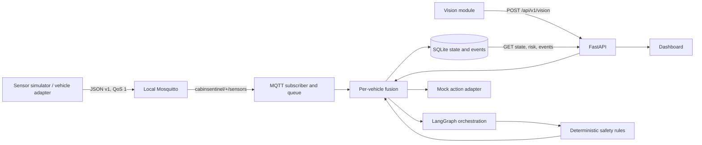

# CabinSentinel Sprint 0 architecture

The safety decision uses local inputs and deterministic rules; no LLM or Internet
service participates. Each accepted MQTT or Vision update reevaluates the vehicle.
The one-second timer also detects stale sources. SQLite persists the latest
decision and action attempts. All action results currently mean **simulated**;
`request_unlock` is pending confirmation only and has no actuator connection.
The health endpoint reports a disconnected broker as degraded.

The original `/api/v1/chat` template route remains available in development and
tests for compatibility. It is disabled by default in production because it is
outside the safety path. Set `AGENT_API_ENABLED=true` only after adding the
required authentication, rate limiting and a production agent implementation.
